# SurePath — App Flowchart (Verified against source)

> Generated from direct code inspection. Controlling files are cited at the head of each section.
> Last verified: 2026-06-13.

---

## 1. Onboarding / Auth

**Controlling files:** `App.tsx`, `components/AuthGate.tsx`, `components/RoleSelectionScreen.tsx`, `components/TermsModal.tsx`, `components/agent/AgentOnboarding.tsx`

```mermaid
flowchart TD
    A([Browser opens SurePath]) --> B{splash done?\ncheckSessionStorage}
    B -- no --> C[SplashScreen\n~3.5 s auto-advance]
    C --> B
    B -- yes --> D{oauthLoading?\ncode= or access_token= in URL}
    D -- yes --> E[PortalLoader — wait\nfor PKCE/implicit resolution\n10 s timeout]
    E --> F{session resolved?}
    F -- timeout/fail --> G[HomePage\npublic landing]
    F -- yes, known user --> TC
    F -- yes, new OAuth user --> RS

    D -- no --> H{localStorage/sessionStorage\nSURPATH_SESSION?}
    H -- yes --> I[Restore session\ncall getUserTcStatus]
    I --> TC
    H -- no --> G

    G --> J[User visits /login\nor /custapp or /agapps]
    J --> AuthGate

    subgraph AuthGate["AuthGate (components/AuthGate.tsx)"]
        AG1{mode}
        AG1 -- LOGIN --> AG2[Email + Password\nsupabase.auth.signInWithPassword]
        AG1 -- REGISTER, Customer --> AG3[Email + Password\nsupabase.auth.signUp]
        AG1 -- REGISTER, Agent --> AG4[AgentOnboarding\n2-step form]
        AG1 -- Google --> AG5[supabase.auth.signInWithOAuth\nprovider: google]
        AG1 -- Email OTP --> AG6[supabase.auth.signInWithOtp\n→ EMAIL_OTP_VERIFY mode]
        AG1 -- Forgot Pwd --> AG7[supabase.auth.resetPasswordForEmail\n→ FORGOT_SENT → email link → RESET_PASSWORD mode]

        AG2 --> AG8{auth error?}
        AG8 -- yes --> AG9[show error]
        AG8 -- no --> AG10[resolveAndLogin\nensureProfile call]

        AG3 --> AG11{session returned?}
        AG11 -- no \nemail confirm required --> AG12[CHECK_EMAIL mode\nresend available]
        AG11 -- yes --> AG10

        AG4 --> AG13[step 1: name/email/phone/password\nstep 2: KTP/address/agree T&C\nsupabase.auth.signUp role=AGENT]
        AG13 --> AG12

        AG5 --> AG14{existing profile?}
        AG14 -- yes --> TC
        AG14 -- no new OAuth user --> RS

        AG6 --> AG15[OTP verify\nsupabase.auth.verifyOtp]
        AG15 --> AG10

        AG10 --> TC
    end

    subgraph RS["RoleSelectionScreen (components/RoleSelectionScreen.tsx)"]
        RS1[New Google user\nselect: Customer / Agent / B2B_CLIENT]
        RS1 --> RS2[enter phone\noptional: referral code, company name]
        RS2 --> RS3[ensureProfile or createB2BClientProfile]
        RS3 --> TC
    end

    subgraph TC["T&C Gate (App.tsx:844, TermsModal.tsx)"]
        TC1{getUserTcStatus}
        TC1 -- not accepted --> TC2[TermsModal: read & checkbox]
        TC2 --> TC3[recordTcAcceptance\nSupabase fn]
        TC3 --> TC4[onDone → portal]
        TC1 -- accepted --> TC4
    end

    TC4 --> RR

    subgraph RR["Role Router (App.tsx:993-1051)"]
        RR1{currentUser.role}
        RR1 -- MASTER_ADMIN / ADMIN / FINANCE /\nFINANCE_MANAGER / FINANCE_DIRECTOR /\nINSURANCE_ADMIN --> AdminPortal
        RR1 -- AGENT --> AgentPortal
        RR1 -- B2B_CLIENT --> B2BPortal
        RR1 -- CUSTOMER default --> CustomerPortal
    end

    subgraph DemoLogin["Demo Accounts (AuthGate.tsx:200)"]
        DL1[demo.customer@myinsurepath.com\nDemo1234!] --> CustomerPortal
        DL2[demo.agent@myinsurepath.com\nDemo1234!] --> AgentPortal
    end

    subgraph AdminLogin["Admin Direct Login (/admin, components/admin/AdminLogin.tsx)"]
        AL1[/admin route\nnon-admin user] --> AL2[AdminLogin form\nemail + password]
        AL2 --> AdminPortal
    end
```

---

## 2. Customer Flow

**Controlling files:** `components/customer/CustomerPortal.tsx`, `components/CarInsuranceWizard.tsx`, `components/car-wizard/Step*.tsx`, `components/ClaimManager.tsx`

### 2a. Customer Portal Navigation

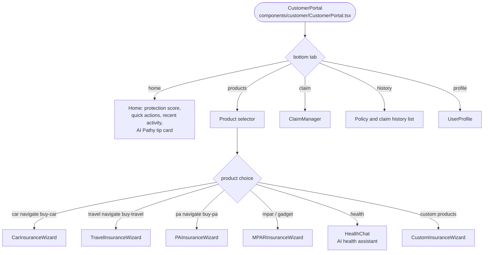

### 2b. Car Insurance Purchase Wizard (step-by-step)

**Controlling file:** `components/CarInsuranceWizard.tsx` lines 20-29 (STEPS array), lines 361-368 (render switch).

Steps in order (index → id → label):

| # | Step ID | Label |
|---|---------|-------|
| 0 | VEHICLE | Data Mobil |
| 1 | COVERAGE | Pilih Proteksi |
| 2 | PROVIDERS | Pilih Perusahaan |
| 3 | KYC | Data Diri |
| 4 | PRESUMMARY | Cek Pesanan |
| 5 | SURVEY | Cek Kondisi |
| 6 | REVIEW | Ringkasan |
| 7 | PAYMENT | Bayar |

```mermaid
flowchart TD
    W0([Start: buy-car\nCarInsuranceWizard.tsx])
    W0 --> S0

    S0["Step 0 - VEHICLE (StepVehicle.tsx)\nBrand / model / year from DB or manual\nPlate auto-detect OJK region\nVIN, engine, color, usage\ngetVehicleMarketValue call"]
    S0 -->|Next| S1

    S1["Step 1 - COVERAGE (StepCoverage.tsx)\nComprehensive vs TLO\nAdd-ons: flood, earthquake, SRCC,\nterrorism, authorized workshop,\nTPL, PA driver, PA passenger\nPremium calc: getOJKRate + EXPANSION_RATES"]
    S1 -->|Next| S2

    S2["Step 2 - PROVIDERS (StepProviders.tsx)\nSort by RATING or PRICE\nSelect insurer from INSURANCE_PROVIDERS\nconstants.ts"]
    S2 -->|Next| S3

    S3["Step 3 - KYC (StepKYC.tsx)\nName, KTP number (OCR-assisted),\naddress, email, phone\nPhoto of KTP via Gemini AI extraction"]
    S3 -->|Next| S4

    S4["Step 4 - PRESUMMARY (StepPreSummary.tsx)\nReview: vehicle data, coverage,\npremium breakdown, KYC summary\nSTNK data shown if extracted"]
    S4 -->|Next| S5

    S5["Step 5 - SURVEY (StepSurvey.tsx)\nUpload STNK photo - extractStnkData Gemini\nUpload vehicle photos 6 angles\nvalidateVehiclePhoto per slot Gemini\nThen analyzeVehicleSurvey - score 0-100\nverdict: CLEAN / REVIEW_REQUIRED /\nREJECTED / MANUAL_REQUIRED"]
    S5 --> S5V

    S5V{AI verdict}
    S5V -- CLEAN or REVIEW_REQUIRED --> S6
    S5V -- REJECTED --> S5R[Blocked: cannot proceed\nNext disabled survey.score=0]
    S5V -- MANUAL_REQUIRED --> S5M[Request manual survey\nVIDEO or PHYSICAL\ndate/type selection]
    S5M --> S6

    S6["Step 6 - REVIEW (StepFinal.tsx)\nFull policy summary:\nvehicle + coverage + AI score + provider\nCheckout button calls handleNext"]
    S6 -->|Checkout step 7| S7

    S7["Step 7 - PAYMENT (StepPayment.tsx)\nMethod: Bank VA BCA/Mandiri/BNI\nor E-Wallet OVO/DANA/QRIS\nor Pay Later"]
    S7 --> PAY

    PAY{payment action}
    PAY -- Pay Now --> PAY1[handlePaymentResult SUCCESS\ncreatePolicyOrder supabaseService\ncreateXenditInvoice paymentService\nopen invoice_url in new tab\norder status: SUBMITTED]
    PAY -- Pay Later --> PAY2[handlePaymentResult PENDING_PAYMENT\ncreatePolicyOrder only\nno invoice created\norder status: SUBMITTED]

    PAY1 --> SUCCESS[Success screen\norder number shown\nlink to Xendit invoice\nonComplete to CustomerPortal home]
    PAY2 --> PENDING[Pending screen\norder saved, pay later\nfrom My Policies history]
```

### 2c. Claims Flow

**Controlling file:** `components/ClaimManager.tsx`

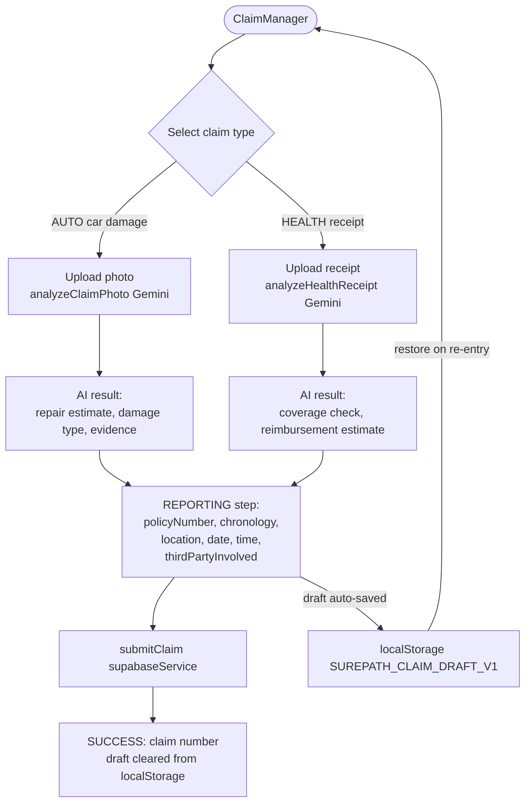

---

## 3. Agent Flow

**Controlling files:** `components/agent/AgentPortal.tsx`, `components/agent/AgentBuyMarketplace.tsx`, `components/agent/VehicleUnderwritingWizard.tsx`, `components/agent/AgentWallet.tsx`

### 3a. Agent Portal Navigation

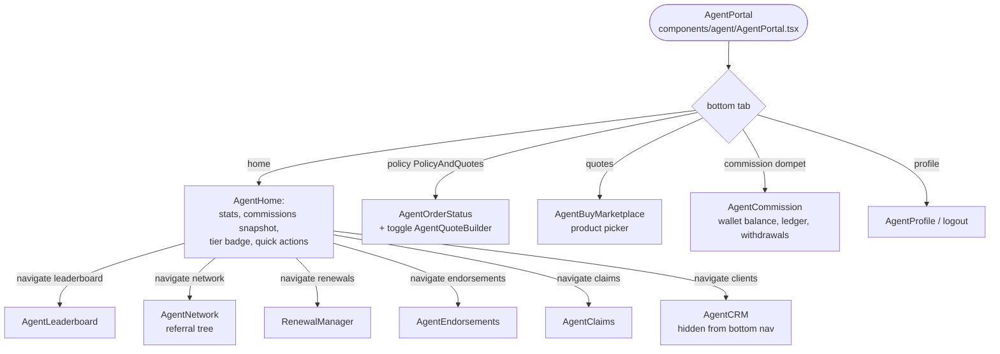

### 3b. Agent Submission / Underwriting Wizard

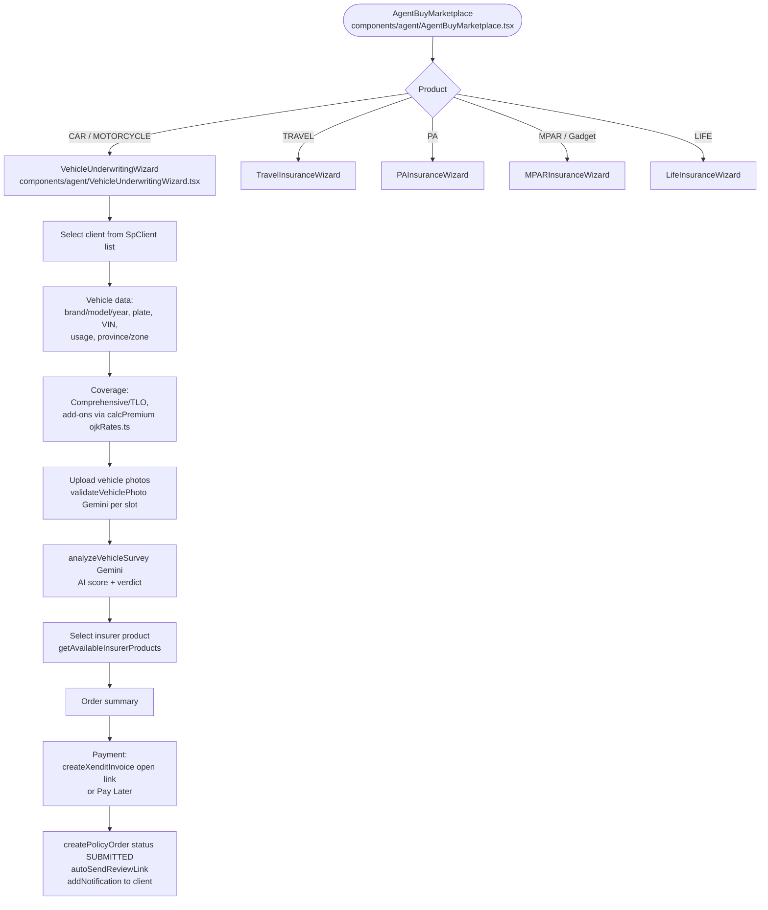

### 3c. Agent Wallet and Withdrawals

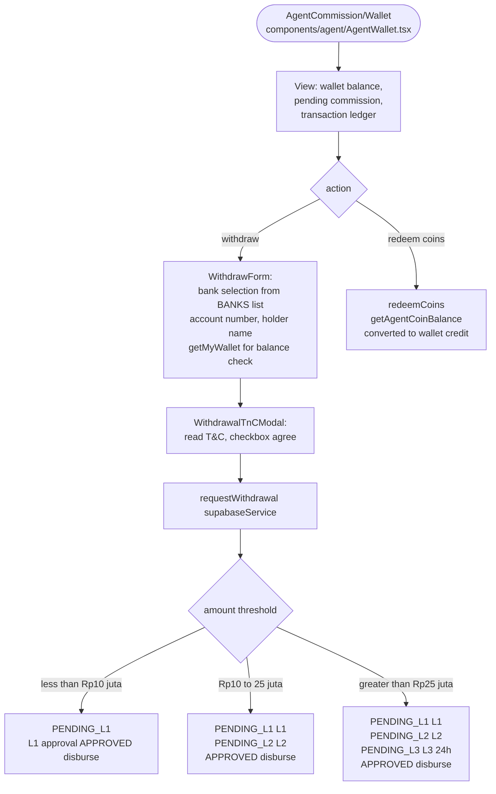

---

## 4. Admin Flow

**Controlling files:** `components/admin/AdminPortal.tsx`, `components/admin/AdminViews.tsx`, `components/admin/PolicyOrdersAdmin.tsx`

### 4a. Admin Portal Structure

```mermaid
flowchart TD
    ADMP([AdminPortal\ncomponents/admin/AdminPortal.tsx])
    ADMP --> SIDEBAR[Sidebar nav\nrole-filtered via MENU_ITEMS + ADMIN_ROLES]

    SIDEBAR --> ADM1[dashboard - DashboardView\nstats: totalOrders, premiumIssued,\npremiumPaid, activeAgents\nonline users, traffic stats]
    SIDEBAR --> ADM2[reports - ReportsView]
    SIDEBAR --> ADM3[analytics - AnalyticsDashboard]
    SIDEBAR --> ADM4[users - BizAdminView]
    SIDEBAR --> ADM5[user_mgmt - UserManagementView]
    SIDEBAR --> ADM6[transactions - LedgerView]
    SIDEBAR --> ADM7[payments - PaymentsAdminView\nXendit payment records]
    SIDEBAR --> ADM8[withdrawals - WithdrawalsAdminView]
    SIDEBAR --> ADM9[policy_orders - PolicyOrdersAdmin]
    SIDEBAR --> ADM10[approvals - ApprovalsView\nqueue of pending orders]
    SIDEBAR --> ADM11[claims_admin - ClaimsAdminView]
    SIDEBAR --> ADM12[inventory - InventoryView]
    SIDEBAR --> ADM13[endorsements - EndorsementsAdminView]
    SIDEBAR --> ADM14[documents - DocumentsAdminView]
    SIDEBAR --> ADM15[agents - AgentManagementView]
    SIDEBAR --> ADM16[commission_ledger - CommissionLedger]
    SIDEBAR --> ADM17[b2b - B2BAdminView]
    SIDEBAR --> ADM18[product_config - ProductConfigAdmin]
    SIDEBAR --> ADM19[tier_promo - TierPromoConfigAdmin]
    SIDEBAR --> ADM20[insurers - InsurerAdmin]
    SIDEBAR --> ADM21[financial - FinancialAdmin]
    SIDEBAR --> ADM22[vehicle_pricelist - VehiclePricelistAdmin]
    SIDEBAR --> ADM23[website_editor - WebsiteEditorAdmin]
    SIDEBAR --> ADM24[ai_admin - AIAdminView]
    SIDEBAR --> ADM25[ai_finance - AIFinanceView]
    SIDEBAR --> ADM26[security - SecurityView]
    SIDEBAR --> ADM27[settings - SettingsView\nwrapped in SettingsErrorBoundary]
```

**Role-based access (AdminPortal.tsx:188-204, MENU_ITEMS:43-83):**

| Role | Access |
|------|--------|
| MASTER_ADMIN | All menus |
| ADMIN | All except product_config, ai_finance, security, settings, website_editor, financial, reports |
| FINANCE | dashboard, reports, analytics, transactions, payments, withdrawals, commission_ledger, financial, ai_finance |
| FINANCE_MANAGER | withdrawals, tier_promo |
| FINANCE_DIRECTOR | withdrawals |
| INSURANCE_ADMIN | policy_orders, approvals, claims_admin, endorsements, documents, b2b, ai_admin |

### 4b. Policy Orders Approval Flow

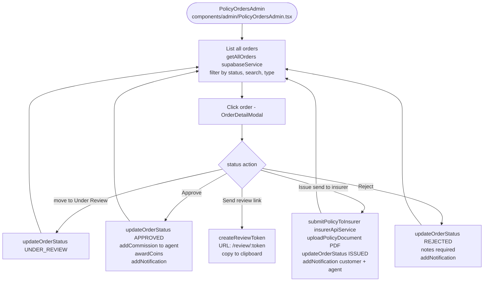

### 4c. Admin Withdrawals Multi-Level Approval

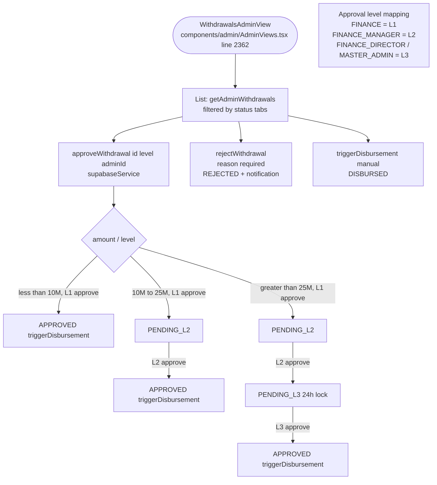

---

## 5. B2B Flow

**Controlling files:** `components/b2b/B2BPortal.tsx`, `components/b2b/B2BNewSubmission.tsx`, `components/b2b/B2BQuotes.tsx`, `components/admin/B2BAdminView.tsx`

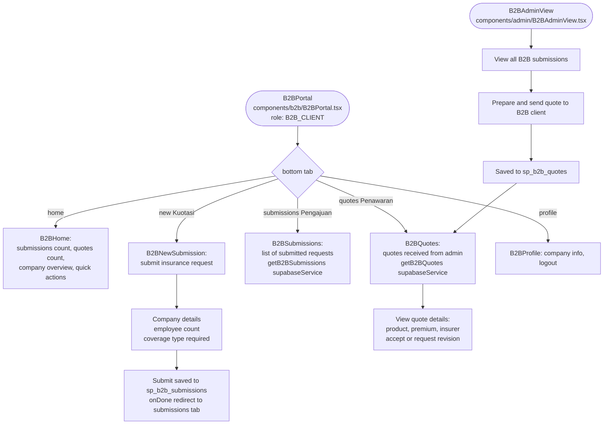

---

## 6. Public / Marketing Routes (unauthenticated)

**Controlling file:** `App.tsx` lines 883-963

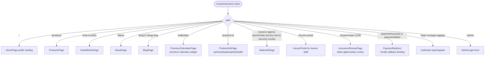

---

## Flow Issues Found

No code was modified. Each entry is a dead end, blocked transition, data inconsistency, or missing file found during flow mapping.

| # | File:Line | Issue |
|---|-----------|-------|
| 1 | `components/agent/AgentPortal.tsx:37-43` | Tab id `clients` is handled in `renderTab` (line 176 returns `AgentCRM`) but is absent from the `TABS` array used to render the bottom nav. `AgentCRM` is reachable only via internal `onNavigate` calls from `AgentHome` — no bottom-nav button exists for it. |
| 2 | `components/agent/AgentPortal.tsx:187-216` | Tabs `claims`, `leaderboard`, `renewals`, `network`, `endorsements` are all handled in `renderTab` but absent from the `TABS` array. They have no bottom-nav buttons and are only reachable through sub-navigation inside `AgentHome`. Users have no direct path back once inside these views other than navigating within them. |
| 3 | `components/CarInsuranceWizard.tsx:395` | The Next button on Step 5 (SURVEY) is disabled when `survey.score === 0`. The score is only set after `analyzeVehicleSurvey` completes. If a user uploads all photos but never triggers analysis, the score stays 0 and the wizard is permanently blocked with no visible prompt to run analysis. |
| 4 | `components/CarInsuranceWizard.tsx:170-232` | `handlePaymentResult` calls `createPolicyOrder` before `createXenditInvoice`. If the Xendit call throws, the order already exists in Supabase as SUBMITTED with no invoice URL. The only error handling is a generic `alert()`. The dangling order has no payment link and cannot be retried from within the wizard. |
| 5 | `App.tsx:844-853` | The T&C check (`showTc`) is set inside `buildAndLogin` which runs before `handleAuthSuccess` sets `entryUser`. After `entryUser` clears (welcome animation, ~2.3 s), `showTc` renders the modal. In practice this ordering is correct, but a very slow `getUserTcStatus` response could let the portal render briefly before the modal blocks it. |
| 6 | `components/AuthGate.tsx:291-299` | `handleSendEmailOtp` uses `shouldCreateUser: false`. If the entered email is not yet registered, Supabase returns success (anti-enumeration) but sends no email. A new user attempting OTP login will see the OTP-verify screen but never receive a code. No guidance in the UI distinguishes this case. |
| 7 | `components/car-wizard/StepSurvey.tsx` | STNK OCR failure (`response.success === false`) sets a local error but does not block progression through the wizard. StepPreSummary (step 4) will show empty placeholder STNK data with no warning to the user. |
| 8 | `components/admin/AdminPortal.tsx:189-203` | Role-based menu filtering reads `localStorage.getItem('SP_ROLE_PERMISSIONS')`. A tampered or malformed value silently falls through to the default role filter with no audit log entry. Server-side RLS is the only enforcement; the client-side filter is purely cosmetic. |
| 9 | `components/b2b/B2BPortal.tsx:55-97` | The `submissions` tab renders `<B2BSubmissions>` but the file `components/b2b/B2BSubmissions.tsx` does not appear in the glob listing of the repository. This is likely a missing or untracked file that would cause a runtime import error when the submissions tab is opened. |
| 10 | `components/CarInsuranceWizard.tsx:264-330` | The wizard success screen calls `onComplete` which navigates back to the `CustomerPortal` home tab. `CustomerPortal` fetches orders only on mount (`useEffect` with `currentUser.id` dep). A freshly purchased policy will not appear in "My Policies" / history until the component unmounts and remounts. |
